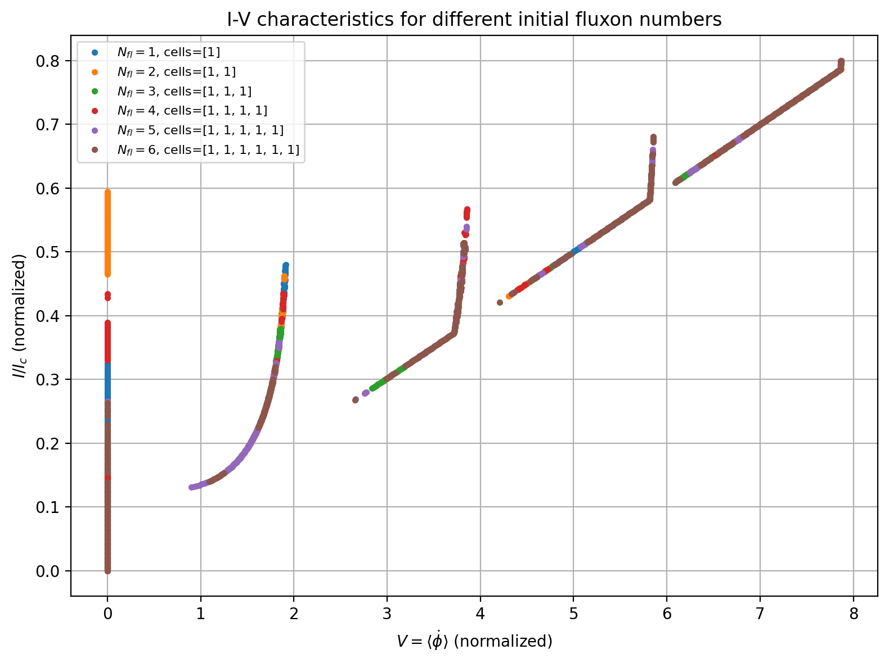

# Long Josephson Junction · Fluxons

Ступени нулевого поля и вольт-амперные характеристики длинного джозефсоновского перехода при разном числе флюксонов в начальном состоянии.



## Модель

Открытая дискретная цепочка RCSJ с индуктивной связью. Начальные условия строятся из кинков `2π`; доступны совместное размещение `same`, разнесённое `spread` и явное задание центров `custom`.

В текущей конфигурации: `N=100`, `alpha=0.1`, `l=0.001`, нулевой внешний поток, 1–6 начальных кинков, скорость `0.9`, размещение `same` в ячейке 1. Нормированный ток меняется от `0` до `0.8` с шагом `0.001`.

## Запуск

```bash
python3 -m venv .venv
source .venv/bin/activate
python -m pip install -r requirements.txt
python iv_multi_fluxons.py
```

Настройки — в нижней части файла. Для каждого числа кинков строится отдельная кривая; расчёты выполняются параллельно. Установлено `reset_each_current=True`: каждая точка тока начинается заново с заданного профиля.

## Результаты

| Путь | Содержимое |
|---|---|
| [iv_multi_fluxons.py](iv_multi_fluxons.py) | Модель, начальные условия, серия токов и экспорт |
| [iv_fluxon_results/](iv_fluxon_results/) | Десять исходных CSV и сохранённые изображения |
| [Дополнительные графики](iv_fluxon_results/iv%20zfs/) | Примеры ступеней нулевого поля |

Новые CSV и PNG сохраняются в `iv_fluxon_results/` относительно текущего рабочего каталога. Колонки CSV: `I_normalized` и `V_normalized_Nfl_…`; напряжение усредняется на выбранном узле по последним 20% записи.

Количество начальных кинков не является гарантией сохранения такого числа возбуждений в открытой цепочке. При центре около границы часть профиля лежит вне расчётного интервала. Старые файлы охватывают разные параметры и версии; название каждого запуска необходимо учитывать отдельно.

## Связанные проекты

[Магнитное поле](https://github.com/asfdqyz/long-josephson-junction-field) · [Флюксоны](https://github.com/asfdqyz/long-josephson-junction-fluxons) · [LJJ + JTL](https://github.com/asfdqyz/long-josephson-junction-jtl) · [Топология LJJ](https://github.com/asfdqyz/long-josephson-junction-chip) · [LC-резонатор](https://github.com/asfdqyz/josephson-lc-resonator)
